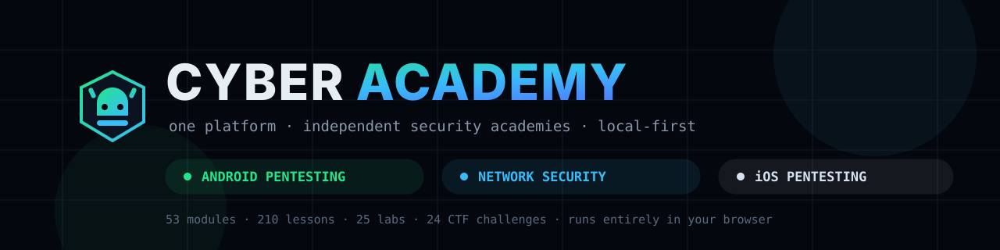

<p align="center">
  
</p>

<h1 align="center">Cyber Academy</h1>

<p align="center">
  <strong>One platform. Independent security academies.</strong><br>
  A local-first, offline-capable security education platform — every academy is a complete, separate
  learning product sharing one engine.
</p>

<p align="center">
  <a href="https://mohamedebeid77.github.io/cyber-academy/">
    
  </a>
  <br>
  <a href="https://mohamedebeid77.github.io/cyber-academy/"><strong>mohamedebeid77.github.io/cyber-academy</strong></a>
  — open it in your browser, no install, no account
</p>

<p align="center">
  <a href="https://mohamedebeid77.github.io/cyber-academy/"></a>
  
  
  
  
  
</p>

---

## The academies

| | Academy | Route | Content | Built on |
| :--- | :--- | :--- | :--- | :--- |
|  | **Android Pentesting Academy** | [`/app`](https://mohamedebeid77.github.io/cyber-academy/app/dashboard) | 14 modules · 68 lessons · 8 labs · 8 CTF · 12 diagrams | AOSP & Android developer docs, OWASP MAS, Frida |
|  | **Network Security & Pentesting Academy** | [`/network`](https://mohamedebeid77.github.io/cyber-academy/network/dashboard) | 15 modules · 66 lessons · 9 labs · 8 CTF · 36 diagrams | Nmap & Wireshark docs, IETF RFCs, MITRE ATT&CK |
|  | **iOS Application Pentesting Academy** | [`/ios`](https://mohamedebeid77.github.io/cyber-academy/ios/dashboard) | 24 modules · 76 lessons · 8 labs · 8 CTF · 34 diagrams · 104-term glossary | Apple Platform Security, Apple Developer docs, OWASP MASVS/MASTG/MASWE |

**53 modules · 210 lessons · 25 labs · 24 CTF challenges · 82 original diagrams** — zero backend,
zero accounts. Progress, notes and XP live in your browser's localStorage, one isolated store per
academy.

### What the iOS academy covers (the newest one)

Platform fundamentals → XNU architecture → reading Swift/ObjC as a tester → IPA & bundle analysis →
the security model (sandbox, Keychain, Data Protection, TCC) → code signing & entitlements → test
environments → static analysis → Mach-O & Ghidra reverse engineering → dynamic analysis → Frida
instrumentation → LLDB debugging → storage & privacy → network/ATS/pinning → authentication &
authorization (BOLA) → deep links & WebViews → cryptography → advanced ARM64 RE → jailbreak
boundaries → anti-analysis & bypass evaluation → patching & re-signing → OWASP MAS mapping → a
22-phase professional engagement methodology with a guided capstone.

---

## Quick start

**No install needed — try it online first:** [mohamedebeid77.github.io/cyber-academy](https://mohamedebeid77.github.io/cyber-academy/)

To run it locally:

```bash
git clone https://github.com/mohamedebeid77/cyber-academy.git
cd cyber-academy
npm install
npm run dev
```

Open **http://localhost:5173** — that's it. No accounts, no cloud, works offline.

| Command | What it does |
| --- | --- |
| `npm run dev` | Start the dev server |
| `npm run build` | Type-check + production build into `dist/` |
| `npm run preview` | Serve the production build locally |
| `npm run lint:content` | Structural lint over all academies' content files |
| `npm run smoke` | Build + execute every route in jsdom, fail on console errors |

Requires Node.js 18+.

---

## What every academy gets (shared engine)

- **Academy home** — progress ring, continue learning, current module, stats, roadmap strip, achievements
- **Learning Path** — level-grouped modules with soft prerequisite locks
- **My Learning Path** — deterministic next-step recommendations (no AI, just your data)
- **Lessons** — a consistent 10-section structure (idea → technical → pentest relevance → what to
  look for → how to test → example → tools → mistakes → try it → takeaways) with objectives,
  original interactive diagrams, code/terminal blocks and knowledge checks (hint → answer → explanation)
- **Labs** — guided scenarios against local, intentionally vulnerable targets with progressive hints,
  expected findings, solutions and remediation
- **CTF mode** — flag challenges with points, hints and solve-gated write-ups
- **Toolkit / Cheat Sheets / Glossary / Sources** — searchable, copy-friendly reference layers
- **Progress** — analytics, activity chart, quiz scores, badges, unlockable skill tree
- **Content Studio** — add your own lessons, modules, labs, CTF, tools and glossary per academy
- **Settings** — profile, reduce-motion, per-academy backup export/import, resets

All content is **original**, synthesized from public official sources (OWASP MAS, Apple & Android
documentation, Nmap/Wireshark manuals, IETF RFCs, MITRE ATT&CK, Frida docs) and attributed per
lesson. Nothing is copied from any commercial course platform. Tool pages combine real interface
screenshots (from [Wikimedia Commons](https://commons.wikimedia.org) under free licenses and
official project repositories — full list in
[`public/tool-images/CREDITS.md`](public/tool-images/CREDITS.md)) with original SVG mock-UIs for
tools that ship no artwork.

---

## Academy isolation

Three academies, three worlds — nothing mixes:

- **Separate routes:** `/app/*`, `/network/*` and `/ios/*` each mount the shared pages under their
  own academy.
- **Separate content:** each academy's curriculum lives in its own directory (`src/data` for
  Android, `src/academies/<id>/content/` for Network and iOS). No cross-links, no shared datasets.
- **Separate progress:** each academy persists to its own localStorage key
  (`android-` / `network-` / `ios-pentesting-academy.v1`) — XP, levels, badges, streaks, notes,
  bookmarks and custom content never mix. Android at 72%, Network at 45%, iOS at 0% is a valid state.
- **Separate identity:** own accent theme (Android = acid green, Network = azure, iOS = platinum),
  badge set, skill tree, level ladder and roadmap.
- Switch academies any time from the **active academy** switcher at the top of the sidebar.

---

## Project structure

```
cyber-academy/
├── index.html
├── package.json
├── vite.config.ts / tailwind.config.js / tsconfig.json
├── .github/workflows/deploy.yml         GitHub Pages build & deploy (on push to main)
├── docs/banner.svg                      repo banner
└── src/
    ├── main.tsx                        entry point (router, Pages base path aware)
    ├── App.tsx                         routes: / (platform hub), /app, /network, /ios
    ├── styles/index.css                design system (dark, glass, glow, per-academy accents)
    ├── types/index.ts                  content + state contract (per-academy diagram id unions)
    ├── academies/                      MULTI-ACADEMY PLATFORM LAYER
    │   ├── types.ts                    AcademyDefinition contract
    │   ├── index.ts                    academy registry
    │   ├── android.ts                  Android academy definition (wraps src/data unchanged)
    │   ├── network/                    NETWORK ACADEMY — isolated content (15 modules…)
    │   └── ios/                        iOS ACADEMY — isolated content
    │       └── content/
    │           ├── meta.ts             levels, badges, skill tree, roadmap
    │           ├── modules/i01..i24.ts 24 module files (lessons, quizzes, references)
    │           ├── labs.ts / ctf.ts    8 labs, 8 CTF challenges
    │           ├── tools.ts            17 tools · cheatsheets.ts (15) · glossary.ts (104 terms)
    │           └── sources.ts          47 official sources
    ├── data/                           ANDROID ACADEMY CONTENT (lessons/m01..m14, labs, tools…)
    ├── context/AcademyContext.tsx      state hub — one instance per academy
    ├── services/                       storage (per-academy keys), search index
    ├── components/
    │   ├── layout/                     app shell, sidebar + academy switcher, search
    │   ├── ui/                         buttons, cards, modals, progress, toasts…
    │   ├── content/                    lesson block renderer (code, callouts, tables…)
    │   └── diagrams/                   82 original SVG diagrams (12 Android · 36 Network · 34 iOS)
    ├── pages/                          shared pages + per-academy homes (Landing, NetworkHome, IOSHome)
    └── utils/                          formatting, lesson source parser
```

**Stack:** React 18 + TypeScript + Vite + Tailwind CSS + react-router. No backend — persistence is
browser localStorage, one key per academy.

---

## Adding an academy (platform extension path)

1. Create `src/academies/<id>/content/` with `modules/`, reference files and a `meta.ts`
   (levels, badges, skill tree, roadmap stages).
2. Add a `DiagramId` union section in `src/types/index.ts` and implement the diagrams in
   `src/components/diagrams/`.
3. Export an `AcademyDefinition` (id, brand, base route, storage key, theme class, content, meta,
   strings) and register it in `src/academies/index.ts`.
4. Mount `<AcademyShell academy={...} />` with the shared route tree in `src/App.tsx` under the new
   base route. Nothing else changes — pages, search, progress and gamification come for free.

## Adding content

### Via the app (Content Studio)

Open **Content Studio** inside any academy. Added lessons, modules, labs, CTF challenges, tools,
cheat sheets, glossary terms and sources merge with that academy's built-in content immediately and
are included in its Settings → Export full backup.

### Via source files

1. **iOS academy:** edit `src/academies/ios/content/modules/iXX.ts` (lesson ids `iXX-lNN`) or the
   reference files next to it.
2. **Network academy:** edit `src/academies/network/content/modules/nXX.ts` (`nXX-lNN`).
3. **Android academy:** edit `src/data/lessons/mXX.ts` (`mXX-lNN`) or `src/data/*`.
4. Wire new modules into the academy's `modules/index.ts` (or `src/data/curriculum.ts` for
   Android), then run `npm run build` — the compiler validates every content file.

### Lesson content syntax (Content Studio)

```
# Sub-heading
A plain line becomes a paragraph.
- Bullet item
1. Ordered item

```bash
nmap -sV target
```

> [!TIP] Optional title
> Callout text — variants: TIP, INFO, WARN, DANGER, NOTE, LEGAL

diagram:net-lan-topology | Optional caption
```

Diagram ids are per academy — see the unions in `src/types/index.ts`
(`AndroidDiagramId` / `NetworkDiagramId` / `IOSDiagramId`).

---

## GitHub Pages deployment

A workflow (`.github/workflows/deploy.yml`) builds and publishes the platform to
**https://mohamedebeid77.github.io/cyber-academy/** on every push to `main`. The Pages build sets
`PAGES_BASE` so both Vite assets and the router resolve under the repo subpath, and `index.html`
is copied to `404.html` so SPA deep links work.

## Backups

- **Export:** Settings (inside an academy) → *Export full backup* / *Export progress only*. The
  filename prefix identifies the academy (`apa-…` / `npa-…` / `ipa-…`).
- **Import:** Settings → *Import backup…* — imports into the academy whose Settings page you used.
- **Storage location:** your browser's localStorage for this origin, one key per academy. Clearing
  browser data wipes it — export first.

## Troubleshooting

- **Blank page / weird state:** Settings → *Reset everything* (after exporting!).
- **Port in use:** `npm run dev -- --port 5174`.
- **Type errors after editing content:** run `npm run build` — the compiler points at the exact line.

---

## Legal

> **Authorized use only.** These academies teach security assessment for defensive and authorized
> testing purposes. All labs and CTF challenges are designed around local, intentionally vulnerable
> training environments or fictional scenarios. Never test applications, devices or systems you do
> not own or have explicit written permission to assess.

iOS, iPhone, iPad, Xcode and macOS are trademarks of Apple Inc. — this independent educational
project is not affiliated with or endorsed by Apple.
